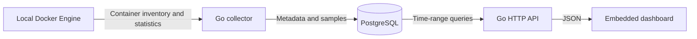

# Initial design and decisions

## Approved by the owner

- Container resource monitoring before application request investigation.
- One local Docker Engine; initial target of 5–10 containers and seven days of history.
- Docker API collection in Go using an existing SDK.
- Plain PostgreSQL for initial persistence.
- A monolith with separate internal responsibilities.

## Data flow

The collector, storage adapter, HTTP API, and dashboard serving run in one Go application. PostgreSQL runs separately. Direct synchronous database writes keep the first slice understandable. Collection is asynchronous to HTTP requests, but there is no message broker or durable ingest queue.

## Implementation choices to review

- Configurable 10-second polling, up to four concurrent stats requests, bounded query and collection timeouts.
- One sample row per Docker container ID and observation timestamp; CPU is nullable, memory is stored in bytes. Recreated containers get new IDs rather than merged histories.
- Docker's observation timestamp is retained and checked for unreasonable skew/staleness.
- CPU uses successive valid Docker counters. 100% corresponds to one core, not the whole machine. Missing initial counters, resets, and gaps produce unknown CPU.
- Memory subtracts inactive file cache using Linux cgroup v1/v2 fields where available. I/O counters and PIDs were added for the first presentable milestone; see the contract below.
- Successful listing updates inventory transactionally. Failed listing preserves the last inventory, which becomes stale. Missing containers retain their histories.
- PostgreSQL primary index supports container/time lookups; a separate time index supports retention. Versioned schema migration 1 runs under a transaction-level advisory lock.
- History queries use mean aggregation with approximately 600 buckets. They expose counts and observed bounds, but do not preserve every raw peak or interior gap in the chart.
- Seven-day cleanup runs every minute in bounded batches; outage backlogs can delay physical deletion. Existing stopped container identities remain available; removed identities expire after their history and seven-day age have elapsed.
- Query failures return service-unavailable errors. No synthetic telemetry fills failure gaps.
- Collection failure degrades health; recovery is attempted on the next cycle. PostgreSQL must be reachable at startup; later outages are retried through subsequent operations.
- Local development uses Docker Compose with app and database published on loopback. Socket access is broad despite a read-only mount; release hardening remains open.
- Dashboard now uses React and TypeScript with a Vite build, as requested by the owner. SVG charts and the compiled frontend are embedded in the Go application; no separate frontend service is deployed.

## Known limitations and next work

No application-health probes, authentication, remote collection protocol, durable buffering, alerting, tracing, log search, or measured performance guarantees. No runtime-enforced cap of ten containers: collection currently discovers every container on the Engine. Target count beyond the planned workload needs measurement and potentially admission controls.

Review the schema and sampling semantics with the owner before expanding the signal set. Confirm Linux Engine compatibility, test resource values against Docker's reference statistics, and run a clean deployment before calling the vertical slice verified.
## First presentable milestone — approved scope, implementation ready for live review

The owner requested React/TypeScript, a container side panel, a cleaner dark presentation, and NET I/O, BLOCK I/O, and PIDs. These extend the existing monolith; they do not add an ingest broker or change the storage engine.

### Measurement contract

- Network totals sum received/sent bytes across reported interfaces. Missing `networks` is unknown; an explicitly empty map is zero. Rates require unchanged interface identities and nondecreasing per-interface counters.
- Block totals sum only Read/Write operations from `io_service_bytes_recursive`, case-insensitively. Total/Sync/Async entries are not added again. Missing/null device entries remain unknown; an explicit empty list is zero. Rates require unchanged device/operation identities and nondecreasing counters.
- PIDs comes from `pids_stats.current`; absence is unknown and explicit zero is preserved. The Linux counter includes tasks/threads, not only user-visible processes.
- I/O rates divide valid counter differences by actual elapsed Docker observation time. There is no rate for the first sample or an invalidated baseline. CPU calculation is independent of I/O availability.
- Integers and aggregate totals are validated before conversion to PostgreSQL bigint. Counter overflow rejects the sample rather than wrapping.
- Migration 002 adds nullable columns. Existing records are preserved, with null for new measurements. Mean rate/PID values are returned in history buckets; latest samples include totals and rates.
- No backfill is attempted. Unsupported counters, inactive targets, and stale samples display a dash. CPU and I/O rate baselines reset after collection or inventory-persistence failures.

### Frontend boundaries

React manages inventory polling, search/filter state, selection, theme preference, and the detail panel. The chart component converts bucket observations into SVG segments with explicit breaks for unknown values and observed gaps. Network and block totals are shown separately from their rate charts.

The drawer is resizable on wider screens. On smaller screens it becomes a modal sheet with Escape and keyboard focus containment. Native buttons/selects and SVG descriptions provide keyboard and screen-reader access; a browser accessibility review is still required.

Docker builds compile the frontend with Node 24, then embed its static output into Go. The runtime remains one Go app and one PostgreSQL service. The development Vite proxy is tooling only.
## Milestone 2 — Docker-backed log snapshots

Approved decisions: read logs directly from Docker, preserve no independent log copy, support stopped containers where available, and use bounded snapshots with an explicit Refresh button. See decisions/0002-docker-log-snapshots.md for the decision and implementation contract.

The HTTP layer validates a full Docker ID and a resource-investigation time window, admits at most four concurrent snapshots, and invokes an independent Docker log service. That service inspects TTY/driver metadata, requests a bounded non-following tail, closes responses on cancellation, and normalizes the returned stream into plain-text lines. PostgreSQL is not involved in log queries and receives no new schema.

The UI shares the selected relative time window. It reuses the exact resource-history query bounds when available and matching that duration; otherwise it constructs the selected relative interval. A snapshot displays its exact absolute bounds and fetch time. Subsequent resource polling does not refetch logs; the user may explicitly refresh to capture current investigation bounds.

Decoder output preserves Docker timestamps and stdout/stderr provenance where available. TTY output is combined. Incomplete lines are buffered per stream, and resulting entries follow completion order rather than claiming strict ordering between interleaved streams. Unsupported drivers, absent containers, empty output, busy capacity, timeouts, malformed output, and truncation are distinct results. No severity inference or persistent search is implemented.

The selected workspace root is now the source checkout. Development caches and user-facing screenshots are excluded from the Docker context and Git. The original generated directory is a preserved baseline; Compose's stable project name preserves the existing named database volume.

## Milestone 3, batch 1 — projects and events

An independent event collector runs within the same Go process and writes selected lifecycle metadata to the existing PostgreSQL database. The inventory collector records Compose project/service labels. Events are not foreign-keyed to inventory: short-lived containers can produce useful evidence between inventory polls. Both collectors use direct bounded writes; there is no added broker or delivery guarantee.

Migration 003 adds project/service metadata and event storage/indexes. The event timeline API supports project/container/time filters, a bounded newest-first result, and explicit coverage/connection status. Replay overlaps saved timestamps and deduplicates normalized event identity. Seven-day cleanup includes events. Docker's bounded replay can leave gaps after outages. Details and reproducible demo instructions: [docs/events.md](events.md).

The React workspace has a shared project selector, a timeline navigation item, and a container Events tab. Logs continue to read directly from Docker without storage; linking a selected event to an exact log/resource window belongs to the next investigation batch. Session storage, alerts and comparisons are subsequent batches with their semantics recorded before implementation.

## Milestone 3, batch 2 — named sessions

The owner selected dynamic project membership and session expiry seven days after finish. Migration 004 adds session boundaries and member identity snapshots to the existing database. Start, inventory reconciliation, event membership writes and finish are serialized by a transaction advisory lock, while a partial unique index enforces one active session per scope. Events can add short-lived members independently of inventory and update finished-session evidence through late in-window replay.

Summaries read one consistent database snapshot and calculate sample-based per-container CPU/memory statistics and lifecycle counts within the retained session interval. They archive neither raw telemetry nor logs; expiry and available coverage are explicit. Active sessions persist across process restart until manually finished. The new local mutation endpoints accept bounded JSON and check browser origin. See [session definitions and API](sessions.md).

## Milestone 3, batch 3 — investigation navigation

React now carries an explicit container ID, absolute range, target tab and source label from events/session members into the existing detail panel. Event context is bounded to retention/now; session navigation reuses the summary's available interval. Pinned ranges override relative history/log queries and survive polling and tab switches. Recorded-only identities can request Docker logs without fabricating current presence. Snapshot search/filter/copy stays in the browser; all existing API/storage/retention boundaries are unchanged. See [investigation definitions](investigation.md).

## Milestone 3, batch 4 — project alerts

The owner chose per-project opt-in. Migration 005 adds rules, alert episodes and condition state to the existing PostgreSQL database. Resource evaluation commits with saved samples; event evaluation commits with saved event/member data. An advisory lock serializes settings and condition transitions, while source event uniqueness and timestamp-aware condition state suppress replay duplicates. No new runtime service or queue is introduced. Dismissal is independent of recovery. Settings changes explicitly retire old episodes without asserting workload recovery. The independent inbox poll and badge expose review state; investigation links reuse Batch 3. Details: [alert semantics](alerts.md).

## Completed-session comparison

Batch 5 is a React view over two existing bounded session-summary reads. No migration or backend service. Each summary retains its own repeatable-read snapshot and `as_of`; the pair is not atomic. The client accepts only distinct completed sessions of the same exact project/Standalone scope and joins member rows by full ID only. No synthetic project resource average/peak or service identity is introduced. Explicit comparison refresh, request cancellation, limits, retained windows and missing evidence are visible. See docs/comparison.md.
